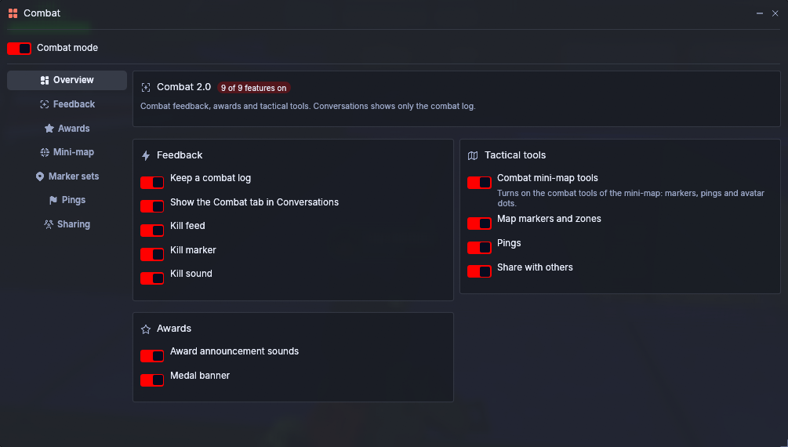
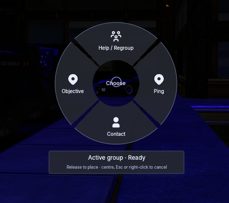
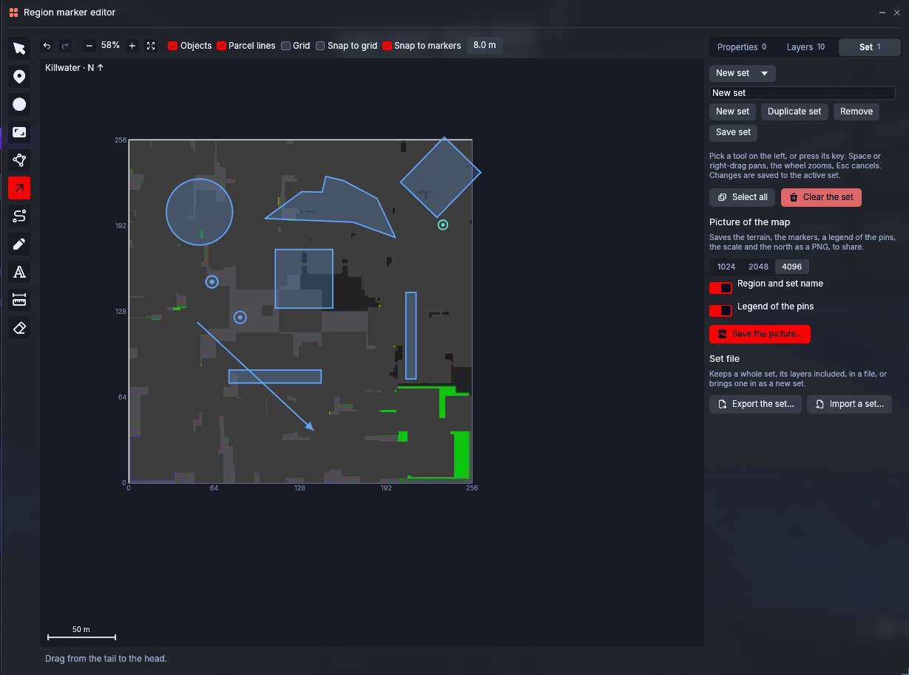

# Aurora Viewer — Combat 2.0

**Combat feedback, tactical communication and battlefield mapping built directly into Aurora Viewer.**

---

## Overview

Combat 2.0 adds an optional set of combat-focused tools to Aurora Viewer.

It brings together combat feedback, combat logging, tactical pings, minimap tools and advanced region annotations in a single native interface, while staying disabled by default for normal viewer use.

---

## Preview

### Combat Overview

  

*Main Combat window with feature toggles, combat log integration and tactical tools.*

### Tactical Pings

Mark contacts, objectives, and regroup points without leaving mouselook. The ping wheel supports quick communication, acknowledgements, and off-screen indicators.

  

### Region Marker Editor

  

*Advanced tactical mapping with markers, zones, layers, set management and PNG export.*

---

## Features

### Combat Feedback
- **Kill Marker** — Customizable on-screen kill confirmation.
- **Kill Sound** — Custom sound support using SL asset UUIDs.
- **Kill Feed** — On-screen list of recent eliminations.
- **Combat Events** — Tracks kills, deaths, suicides and environmental deaths.

### Awards & Medals
- **Combos** — Double, Triple, Quadruple and Pentakill: kills less than 5 seconds apart.
- **Streaks** — 10, 20, 30 and 50 kills without dying.
- **Events** — Revenge, Domination, and Shutdown when you end someone's streak of 5 kills or more.
- **One announcement per kill** — the biggest medal gets the sound and the banner, the others show as small chips.
- **Award Studio** — Rename every medal, switch medals and families on or off, set a volume per family, configure images and sounds, preview them, and adjust the banner (size, duration, position, calm animation).
- **Medals of everyone** — The kill feed and the journal list the medals earned by anyone on the region.
- **Kill feed styles** — Compact or cards, filtered to everyone, only you, or your allies and you. Allies are coloured, friendly fire is flagged, and a test mode lets you drag the feed anywhere.

### Combat Log
- **Dedicated Combat Tab** in Conversations.
- **All / Mine filters** for combat events.
- **Optional JSONL logging** for session history.
- **Fight recaps** — kills, deaths, best streak and medals once a fight is over.

### Tactical Pings
- **Quick Ping** from crosshair or aim position.
- **Ping Wheel** with Contact, Objective, Help / Regroup and default Ping.
- **Acknowledgements** such as *On my way*.
- **Off-screen indicators** for navigation.
- **Mouselook support**.

### Allies
- **Allies tab** in the Combat window: tick the residents around you, ally the group you wear, or ally a group title you see over someone's head.
- **Pings go to your allies** straight away, and you accept theirs. The Sharing tab keeps one choice of who receives (only you, or your allies) and sends you to the Allies tab to manage them.
- **Own colour on the minimap** (configurable), with an optional ring.

### Tactical Mapping
- **Combat Minimap** with persistent markers and direct editing.
- **Region Marker Editor** with pins, circles, rectangles, polygons, arrows, routes, text and freehand tools.
- **Layers, snapping, presets and undo/redo**.
- **Map tab** — Tactical, Detailed and Clean looks, plain or terrain ground, ground brightness, objects, parcel lines and grid.
- **JSON set import/export**, optionally with the map look.
- **PNG map export** for sharing annotated maps.

### Additional Features
- **Zoomed Aim Sensitivity** in mouselook.
- **Dedicated Combat Window** for all settings.
- **Localized UI** in English, French and Japanese.
- **All features disabled by default**.

---

## Status

> [!NOTE]
> Combat 2.0 is currently in **pre-release development**.
>
> Features are implemented and tested offline, but live-grid validation is still pending.

---

## License

Licensed under **GPLv3**, following Aurora Viewer.

See [LICENSE](LICENSE) and [NOTICE.md](NOTICE.md).

*Not affiliated with or endorsed by Linden Lab.*
